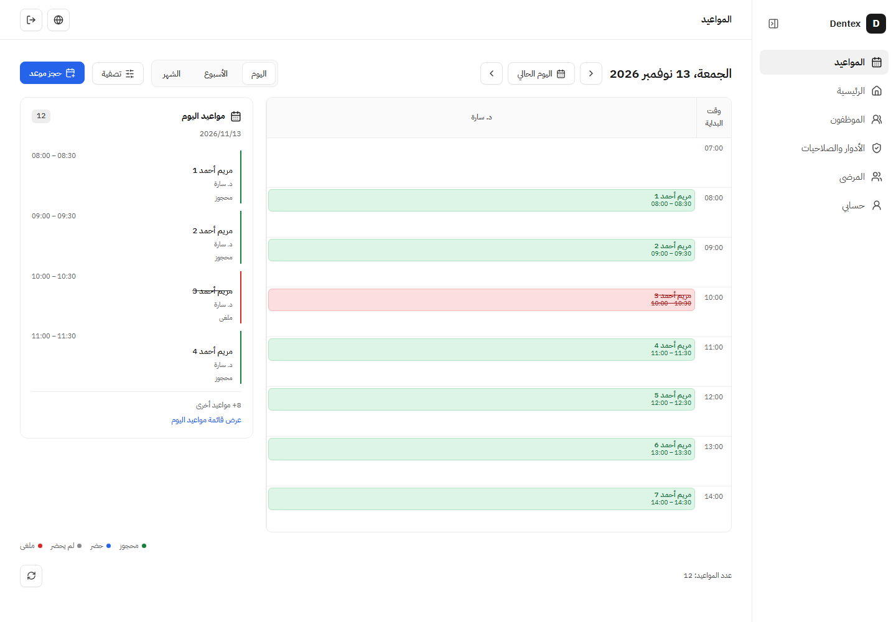
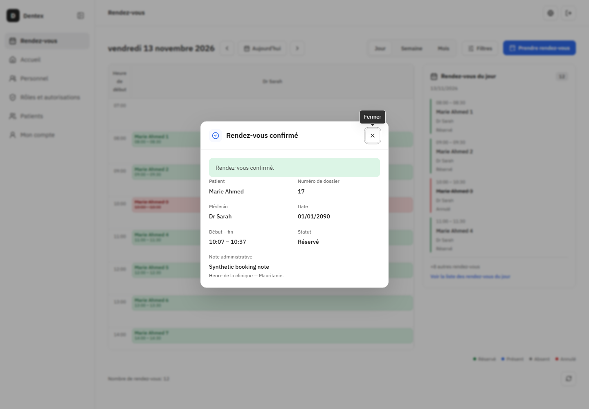
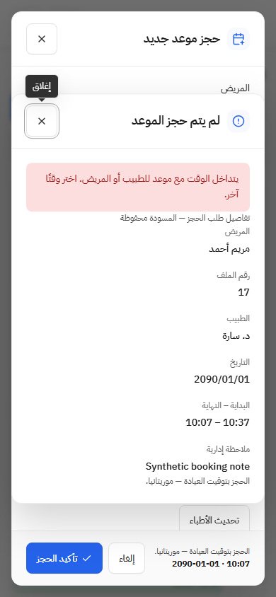

# التحقق — نتيجة الحجز وبطاقة اليوم

2026-11-13. [تذكرة06](issues/06-booking-result-and-day-summary.md) مكتملة تقنيًا وجاهزة لفحص المستخدم. هذه متابعة صريحة بعد دمج01–05، وليست إعادة فتح للتذاكر المدمجة أو اعتمادًا بصريًا بالنيابة عن المستخدم.

## السلوك الحالي

- أزيل علم النجاح والبانر الدائم من BookingAction. تعرض Modal مشتركة نتيجة الحجز واسم المريض ورقم ملفه والطبيب والتاريخ ووقت البداية والنهاية والملاحظة. حالة محجوز تظهر بعد201 صالح فقط؛ إغلاق النجاح يزيل الملخص ويعيد التركيز إلى زر الحجز.
- الرفض يعرض سببه وبيانات الطلب في نافذة منفصلة؛ إغلاقها يعيد إلى النموذج ومسودته. انقطاع الرد و500 والنتيجة الناقصة تبقى نتيجة غير مؤكدة دون نجاح أو فشل مؤكد أو إعادة إرسال. الحفظ يظل معطلًا فيها؛ يعود التركيز إلى الملاحظة القابلة للتفاعل بدل زر معطل.
- اليوم شبكة2:1: ثلثان للجدول الزمني وثلث لبطاقة اليوم على المكتب والتابلت، وتكديس على الهاتف. تعرض البطاقة أول أربعة مواعيد والعدد المتبقي؛ النقر عليها أو Enter يفتح قائمة اليوم. تبقى صفحات اليوم متاحة داخل النافذة إذا تجاوز العدد50، مع فتح التفاصيل الحالي.
- المظهر الجديد في client/ui/components.css، والتوزيع فقط في appointments.css. Modal تفوض onCloseAutoFocus إلى Radix؛ السلوك الافتراضي لبقية المستهلكين باقٍ. لا اعتماد أو مكتبة أو خادم أو مخطط أو ترحيل أو صلاحيات أو عقد HTTP جديد.

## الفحص

- **216/216** اختبار واجهة في33ملفًا، دون فشل أو تخطٍّ أوtodo، مع نجاح مانع التقرير. شملت الحجز من الملف والشاشة، والتسجيل، وفقد الرد وسحب الصلاحية والمسودة والتقويم واللغتين. أضيف اختباران لبطاقة اليوم وقائمة مواعيدها والتنقل بين الصفحات والتفاصيل وإرجاع التركيز؛ عُدلت توقعات النجاح والرفض لتختبر النافذة الجديدة.
- بعد تحسين إرجاع التركيز في الحالة غير المؤكدة أعيدت **9/9** اختبارات الحجز المتأثرة ومانع تقريرها. لم تُنسب المجموعة216 إلى الإضافة الصغيرة اللاحقة دون هذه الإعادة المحددة. التقارير الخام: `.worktrees/appointments-feedback/client-final.json` و`booking-final.json`.
- نجح البناء وTypeScript وcheck:ui-styles ومعماريتا الخادم والواجهة. تحذير حزمة680.98KB باقٍ دون تخفيف الحد. فحص git diff --check ناجح.
- Chromium حقيقي: ست مجموعات AR/FR على1440×1000 و900×1100 و390×844، تتضمن18 نتيجة للحجز: النجاح والرفض والتعذر في كل مجموعة. أثبتت حذف النجاح بعد الإغلاق، ملخص10:07–10:37، حفظ المسودة، إغلاقًا علويًا، حصر التركيز وإرجاعه، وبقاء POST واحد لكل محاولة دون إعادة تلقائية. أثبتت قائمة12موعدًا من بطاقة بأربعة ملخصات و‎+8، والتنقل بالمفاتيح وصفرpageerrors وعدم تجاوز عرض الصفحة. استخدم السيناريو تقليل الحركة؛ لا يدعي تدقيق حركة جديدًا.
- القياسات الفعلية: مكتب العربية749.33px للجدول و374.66px للبطاقة، بنسبة2:1؛ نُفذت النسبة نفسها في الفرنسية وعلى900px. الهاتف يكدس القسمين وتبقى الشبكة قابلة للتمرير داخل حاويتها. الصور التالية قُرئت بصريًا وقورنت بمرجع DayView وقرارات المكونات؛ التقسيم الجديد توجيه المستخدم اللاحق للصورة، ولا ادعاء مطابقة بكسلية.
- جميع API في فحص المتصفح مصطنعة ومعترضة، بما فيها POST؛ لم تصل كتابة إلى API أو قاعدة التطوير. هذه أدلة تفاعل وقياسات للواجهة؛ لم يُعد اختبار خادم/تخزين كامل لأن الخادم وعقوده لم يتغيرا. لا هاتف مادي أو قارئ شاشة فعلي أو قبول بصري مفترض.

## المراجعة والتشغيل

جُلب origin/main حديثًا عند `19510eeb74d423d4aba74a27f1ccbfa80b33079a`. المراجعة ذاتية للمعايير والمواصفة، وتشمل الفرق والملفات الجديدة وغير الملتزم بها. الفرع `codex/appointment-feedback-day-agenda`؛ تغييرات إغلاق التذاكر والتسليم السابقة محفوظة. لم يُفحص odontogram/ أو debug.log أو مجلد fixture المجهول، ولا تُضاف إلى العمل.

نجح check:dev بجميع16فحصًا بعد التنفيذ: D:/dentex على5151/API5152 وdentex_dev55460 وحاوية dentex-database-1 وvolume dentex_database_data محفوظة وشغالة. لا seed/reset أو اختبار على dev أو تعديل حسابات أو كلمات مرور أو منح. النتيجة جاهزة لفحص المستخدم على http://127.0.0.1:5151/clinic/appointments؛ لا commit أو push أو PR أو دمج أو نشر في هذه المتابعة.

## اسم اليوم الكامل في الملخص — 2026-11-13

بطلب المستخدم أضيف اسم يوم كامل بجانب التاريخ في ملخص نتيجة الحجز، بالعربية والفرنسية وتوقيتAfrica/Nouakchott والتقويم الميلادي. تنسيق محلي للملخص فقط دون تعديل التواريخ في الجداول أو CSS أو العقود.9/9 اختبارات الحجز والبناء والأنواع وUIstyles ناجحة؛ Chromium بست مجموعات AR/FR على1440/900/390 أثبت الأحد/dimanche لتاريخ2090-01-01 وبقاء حدود النافذة والإغلاق والقيم والطلب الواحد سليمة. APIمصطنعة بالكامل؛ لا اختبار تخزين جديد أو حسابات المستخدم. صور وتقرير .worktrees/appointments-weekday/browser.json، ونجحcheck:dev الكامل وبقي التطبيق والقاعدة الدائمة شغالين.
