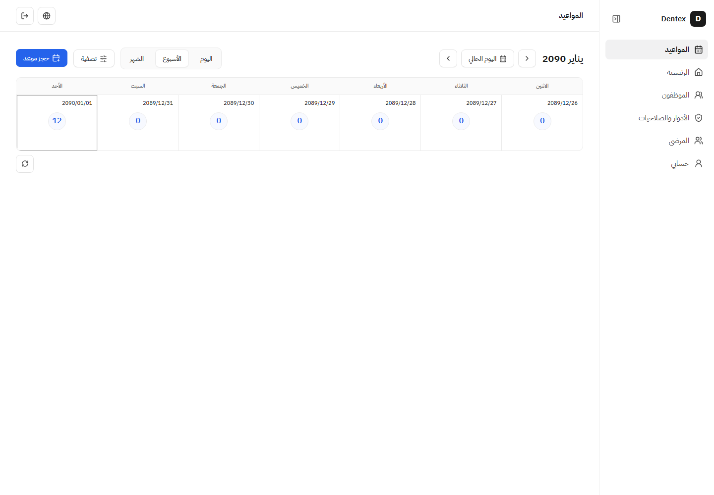
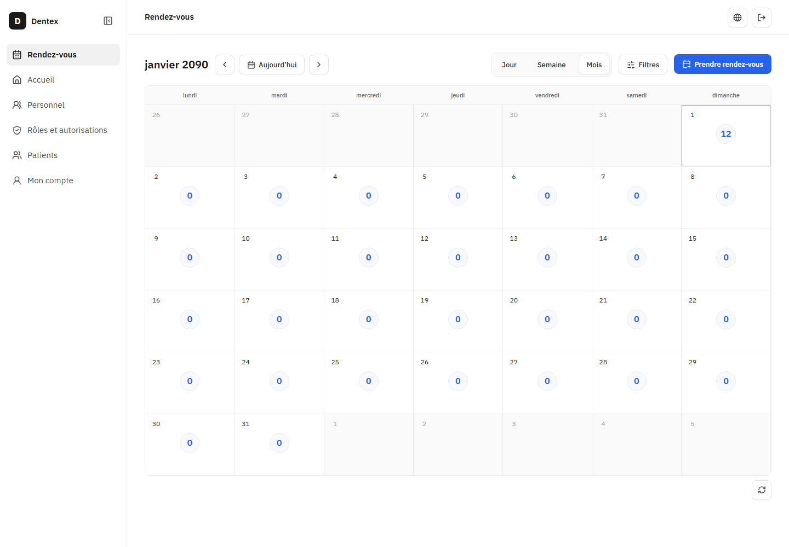
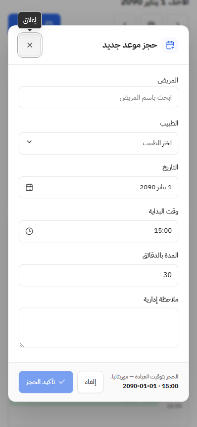

# التحقق — الحجز من ساعات اليوم وأعداد الفترات

2026-11-13. [تذكرة07](issues/07-calendar-hour-booking-and-period-counts.md) مكتملة تقنيًا وجاهزة لفحص المستخدم، بعد متابعة06 المحلية. لا اعتماد بصري بالنيابة عن المستخدم أو رفع أو PR في هذه الخطوة.

## السلوك والملكية

- الساعة وخانات الساعات في عرض اليوم أزرار أصلية متاحة بالضغط وEnter. تفتح نموذج BookingDialog نفسه بتاريخ اليوم المختار ووقتHH:00؛ يبقى تعديل الوقت والتاريخ متاحًا. لا يختار النظام مريضًا أو طبيبًا تلقائيًا، ولا يصف الخانة بأنها متاحة للحجز بصورة مؤكدة.
- القيم الافتراضية وحدها لا تستدعي تأكيد تجاهل؛ تعديلات المستخدم والاختيار والتسجيل والإرسال الجاري والنتيجة غير المؤكدة تحافظ على حراسة المسودة القائمة. إغلاق النموذج أو نتيجة النجاح يعيد التركيز إلى الساعة/الخانة الأصلية. حجز الشريط التالي يبدأ بلا قيم مقتبسة من الحجز السابق. القراءة وحدها تعطل الحجز من الساعات.
- الأسبوع والشهر شبكة أيام بأعداد فقط، بما فيها صفر، دون أسماء أو بطاقات أو ساعات. الضغط على العدد يفتح قائمة يومه، ثم التفاصيل والإجراءات القائمة. تبقى الفلاتر وقراءة كامل الفترة والمنطقة الزمنية والحدود الميلادية كما كانت. تواريخ الأسبوع كاملة لتمييز عبور الشهر والسنة؛ لا مفتاح ألوان للحالات في عرض الأعداد.
- BookingDialog مشترك داخل ملفات الميزة فقط؛ لم يتغير index.ts أو الواجهات المعلنة بين الميزات أو تركيب app أو تنظيم الموديولات. لا تغيير خادم أو صلاحيات أو مخطط أو ترحيل أوHTTP أو مكتبة. ui/components.css يملك مظهر الساعة والخانة والعدد؛ التوزيع داخل الميزة.

## الأدلة

- **219/219** اختبار واجهة في33ملفًا دون فشل أو تخطٍّ أوtodo، ونجاح مانع التقرير. أضيفت ثلاث حالات للحجز من الساعة باللغتين وإرسال الوقت المعدل ومنع القراءة وحدها؛ حُدثت توقعات الأسبوع والشهر لتختبر العدد ثم القائمة. اختبارات06 للحجز والنتيجة والمسودة والتسجيل باقية وناجحة.
- بعد تحسين إظهار تاريخ الأسبوع وإخفاء مفتاح الحالات أعيدت **10/10** حالات التقويم ومانع تقريرها. الملفات الخام في `.worktrees/appointments-calendar-click/client.json` و`calendar-final.json` و`targeted.json`، ولا تُنسب المجموعة الكاملة إلى تعديل المظهر اللاحق دون هذه الإعادة المتأثرة.
- نجحت الأنواع والبناء وcheck:ui-styles ومعماريتا الخادم والواجهة. الواجهة123موديولًا/469اعتمادًا والخادم82/232؛ تحذير الحزمة681.69KB باقٍ دون تعديل الحد. git diff --check ناجح.
- Chromium فعلي: ست مجموعات AR/FR على1440×1000 و900×1100 و390×844. النقر على14:00 يفتح نموذجًا بتاريخ2090-01-01 ووقت14:00، وإغلاقه دون تغيير يعيد التركيز بلا نافذة تجاهل. Enter على خانة15:00 يفتح النموذج، ثم تعديل الوقت إلى15:07 وحفظه يرسل POST واحدًا بالقيم الجديدة، وتظهر نتيجة15:07–15:37 ويعود التركيز إلى الخانة.
- في كل مجموعة أثبت المتصفح غياب الأسماء والبطاقات والساعات من الأسبوع والشهر، وفتح العدد12 لقائمة12موعدًا وفتح الصفر لقائمة فارغة، وإرجاع التركيز إلى العدد بعد الإغلاق. صفرpageerrors، ولا تجاوز لعرض الصفحة؛ تمرير الشبكة محصور بحاويتها على الهاتف. قُرئت لقطات المكتب والهاتف فعليًا مقابل المرجع وقرار المستخدم اللاحق، دون ادعاء مطابقة بكسلية.
- جميع طلبات API في المتصفح معترضة، بما فيها POST، وببيانات مصطنعة؛ لا كتابة وصلت إلى API الفعلي أو قاعدة التطوير. هذا فحص تفاعل الواجهة وعقد الطلب، وليس اختبار تخزين فعلي جديدًا. لا تغيير خادم يستلزم إعادة المجموعة الخلفية أو أي ترحيل. لا هاتف مادي أو قارئ شاشة فعلي أو تدقيق حركة جديد؛ استُخدم reduced-motion في السيناريو.

## المراجعة والتشغيل

مرجع المراجعة origin/main المجلوب حديثًا `19510eeb74d423d4aba74a27f1ccbfa80b33079a`. مراجعة ذاتية تشمل الفرق والملفات الجديدة وغير الملتزم بها، مع حفظ عمل06 وتوثيق إغلاق التذاكر السابقين. لا وكلاء أو مراجعة مستقلة مفترضة، ولا فحص لملفات odontogram/ وdebug.log وfixture المجهولة.

نجح check:dev بجميع16فحصًا: D:/dentex5151/API5152 وقاعدةdentex_dev55460 وحاويةdentex-database-1 وvolume dentex_database_data محفوظة وشغالة. لا seed/reset أو اختبار بيانات علىdev أو تغيير حسابات أو كلمات مرور أو منح. الفرع codex/appointment-feedback-day-agenda والتغييرات محلية غير ملتزم بها؛ لا push/PR/merge أو نشر. النسخة جاهزة لفحص المستخدم على http://127.0.0.1:5151/clinic/appointments.

## فاصل عمود الساعات — 2026-11-13

بطلب المستخدم أضيف border-inline-end:1px solid var(--border) إلىui-calendar-hour عندمالكالمظهرclient/ui/components.css. ست مجموعاتChromium باللغتين وثلاثةمقاسات أثبتت حدًا فعليًاصلبًا1px لكلساعاتاليومالـ24، علىاليسارللعربيةوعلىاليمينللفرنسية، ومتصلًابحدالترويسة ومحاذيًالعمودالمواعيد، دونoverflow. قُرئتلقطةالمكتبالعربيةبصريًا؛ APIمصطنعةللقراءةفقط، ولاكتابةأومساسبقاعدةdev. UIstyles وcheck:dev ناجحان؛ لمتُعداختباراتالوظائفأوالبناءلهذاالتعديلCSSالمحدود. تقريرbrowser.json ولقطات .worktrees/appointments-hour-divider/ هيالأدلةالخام.
