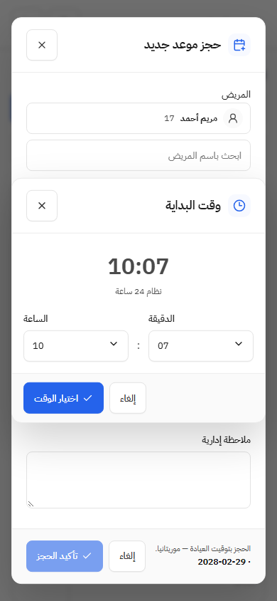
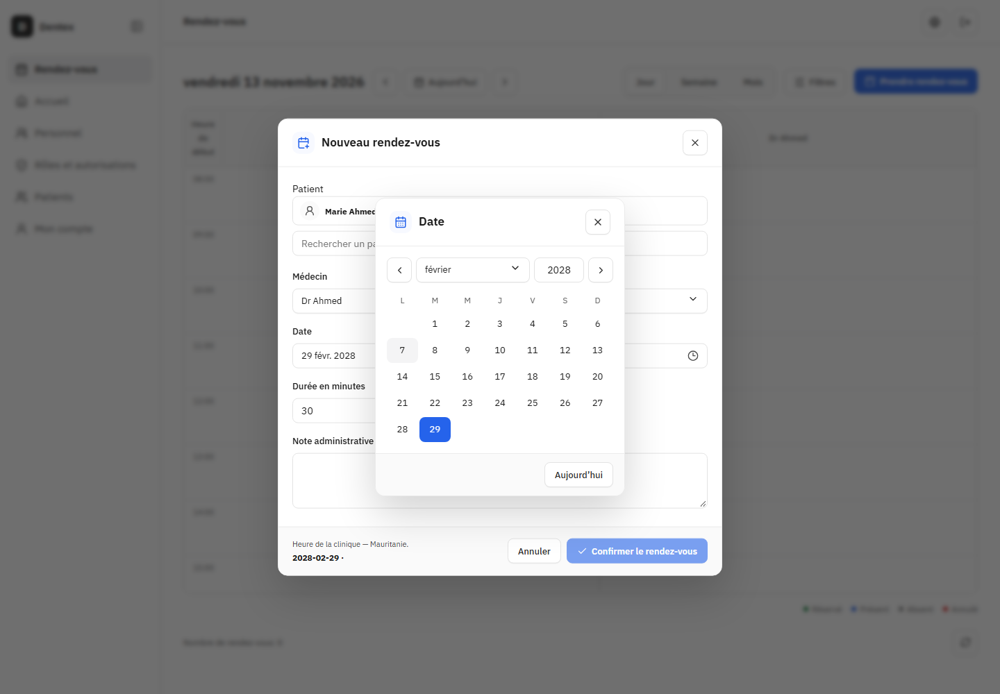

# لقطات مراجعة UI — 2026-11-13

لقطتان من إعادة فحص Chromium الحالية: وقت مخصص بالعربية على390×844، وتقويم مخصص بالفرنسية على1440×1000. كل الأسماء والأرقام مصطنعة، وجميع طلبات API معترضة؛ يسمح السيناريو بـGET فقط ويرفض أي كتابة. لا جلسة أو بيانات للمستخدم.

اللقطات دليل على الشكل المرصود، وليست إثباتًا لمطابقة بكسلية أو قبول المستخدم. راجع [قرارات UI](../ui-decisions.md) و[التدقيق قبل PR](../pr-spec-audit.md) وحدود العرض المعلقة فيه.

