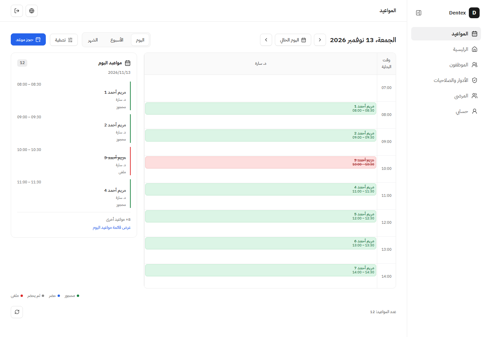
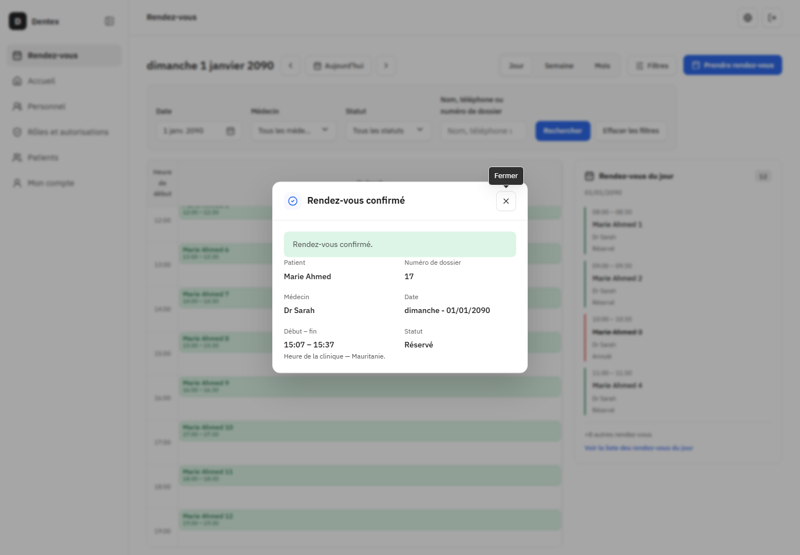
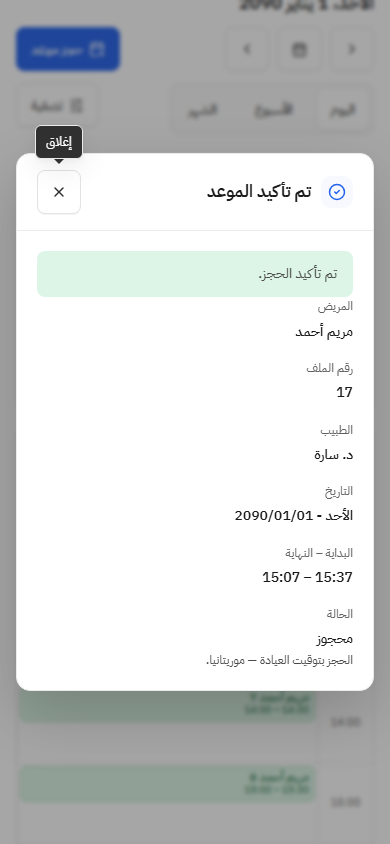

# مراجعة PR لمتابعات واجهة المواعيد

2026-11-13. طلب المستخدم الآن فتح PR، وهذا إذن بالحفظ والرفع وفتح الطلب، دون دمج أو نشر. يشمل متابعتي06 و07 وتعديلات اسم اليوم والشرطة والفاصل العمودي، مع توثيق إغلاق01–05 بعد دمجPR #13. لا يُفترض قبول بصري شامل أو إغلاق06/07 لمجرد طلب الرفع.

مرجع المراجعة origin/main المجلوب حديثًا: `19510eeb74d423d4aba74a27f1ccbfa80b33079a`. شملت المراجعة الذاتية الفرق والملفات الجديدة وغير الملتزم بها المعنية. لا وكلاء أو مراجعة مستقلة مفترضة. [سجل القرارات الحالي](ui-decisions.md) و[دليل06](booking-result-day-summary-verification.md) و[دليل07](calendar-hour-period-counts-verification.md) مصادر نطاق التنفيذ وأدلته التاريخية.

## تغطية طلبات المستخدم

| الطلب | التنفيذ الحالي |
| --- | --- |
| إزالة بانر نجاح الحجز الدائم | نافذة قابلة للإغلاق بملخص المريض والطبيب والتاريخ والوقت والنتيجة؛ إغلاق النجاح يزيله ويعيد التركيز. |
| عرض النجاح أو الفشل | رفض مؤكد يحفظ المسودة، وفقد الرد حالة غير مؤكدة مستقلة مع منع تكرار الكتابة؛ لا نجاح تفاؤلي أو إعادة إرسال تلقائية. |
| اليوم ثلثان وثلث | جدول زمني وبطاقة تعرض أربعة ملخصات وعدد البقية، وتفتح قائمة اليوم مع الوصول إلى الصفحات؛ يتكدسان على الهاتف. |
| الحجز من الساعة | الساعة والخانة تفتحان النموذج نفسه بقيم تاريخ اليوم وHH:00 قابلة للتعديل؛ لا اختيار تلقائي لمريض أو طبيب أو ادعاء توفر. |
| الأسبوع والشهر أعداد فقط | عدد لكل يوم يفتح قائمته، بما فيه صفر؛ لا أسماء أو بطاقات أو ساعات في الشبكتين. |
| اسم اليوم كاملًا وشرطة | «اسم اليوم - التاريخ» في ملخص النتيجة، بالعربية والفرنسية والتقويم الميلادي وتوقيت العيادة. |
| فاصل عمودي للساعات | حد منطقي1px محايد ومتصل بالترويسة، يسار الساعات بالعربية ويمينها بالفرنسية. |

## مراجعة المعايير والمخاطر

تبقى الصادرات المعلنة فيindex.ts وتركيبapp وHTTP والخادم والمخطط والصلاحيات بلا تغيير. يستخدم الحجز من الساعة BookingDialog داخليًا داخل ميزة المواعيد. بيانات النجاح من201 المعتمد، وملخص الطلب محفوظ أثناء الإرسال ولا يتبدل مع تحديث قراءة الأطباء. الحراسة باقية عند التعديل والانقطاع والتسجيل؛ القيم الافتراضية وحدها ليست تعديلًا. القراءة وحدها لا تتيح الحجز من الساعة.

المظهر فيui والتوزيع فيالميزة. خاصيةModal الاختياريةonCloseAutoFocus تفوض حدثRadix فقط، وتحافظ على السلوك الافتراضي لبقية النوافذ. المساحة المتأثرة المواعيد وأنماط جديدة فيCSS المشترك؛ لا تعديل مدمر أو ترحيل، ويمكن الرجوع عن الواجهة دون تغيير بيانات المواعيد.

اختبارات التفاعل تحاكيAPI؛ لا اختبار جديد للتخزين الفعلي أو تشغيل المجموعة الخلفية كاملة لأن الخادم وعقوده لم يتغيرا. أدلة المتصفح مصطنعة بالكامل، ولا حسابات أو بيانات للمستخدم. لا ادعاء قارئ شاشة فعلي أو هاتف مادي أو مطابقة بكسلية أو نجاحCI بعيد قبل قراءته.

## لقطات النسخة الحالية

صور الأسبوع والشهر الحالية في [دليل07](calendar-hour-period-counts-verification.md). نتائج الفحص الطازجة ورابط الطلب تضاف عند اكتمالها.

## التحقق الطازج قبل الرفع

نجحت **219/219** حالة واجهة في33ملفًا على النسخة النهائية دون فشل أو تخطٍّ أوtodo، ونجح مانع التقرير. التقرير الخام .worktrees/appointments-weekday-dash/pr-client.json. نجح build/TypeScript ومعمارية الخادم82/232 والواجهة123/469 وcheck:ui-styles وgit diff --cached --check. حزمة682.07KB ما زالت تعطي التحذير القائم دون تغيير الحد. ظهرت تحذيراتrouter في تجهيزات بعض اختباراتhistory، دون إخفاق.

نجحcheck:dev بجميع16فحصًا؛ D:/dentex5151/API5152 وdentex_dev55460 والحاوية والvolume والحسابات والبيانات محفوظة وشغالة. لاseed/reset أو اختبار علىdev أو تعديل حسابات أو منح أو كلمات مرور. أدلة المتصفح السابقة المرتبطة تشمل العربية والفرنسية وثلاثة مقاسات والنتائج والأعداد والفاصل واسم اليوم والشرطة، على API مصطنعة. لا ادعاء CI بعيد جديد. الملفات المجهولة odontogram/ وdebug.log و.scratch/frontend-fixture-ASuHzC/ خارج الحفظ والرفع ولم يُفحص محتواها.

## PR المتابعات المفتوح — 2026-11-13

فُتح [PR #14](https://github.com/aymanobeid0/dentex/pull/14) غير مسودة بعد رفع041b620، ليجمع06/07 واسم اليوم والشرطة وفاصل الساعات.219/219 واجهة والبناء والفحوص ناجحة محليًا؛ لا دمج أو نشر أو اعتماد بصري شامل أو نجاحCI بعيد مفترض.
